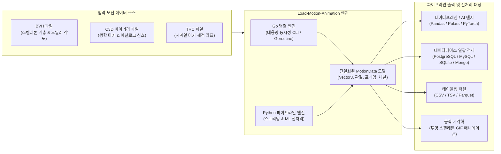

# Load-Motion-Animation 🎬

<p align="center">
  <strong>고성능 3D/2D 모션 캡처 파서, 대용량 배치 전처리 및 파이프라인 엔진</strong><br>
  <em>AI 모션 생성 모델(Text-to-Motion), 딥러닝 데이터 전처리, 생체역학 및 3D 애니메이션 파이프라인을 위한 통합 솔루션</em>
</p>

<p align="center">
  <a href="https://github.com/Mireu-Lab/Load-motion-animation/-/pipelines"></a>
  <a href="https://pkg.go.dev/github.com/Mireu-Lab/Load-motion-animation"></a>
  <a href="https://golang.org"></a>
  <a href="https://python.org"></a>
  <a href="LICENSE"></a>
</p>

<p align="center">
  <a href="README.md">English</a> | <a href="README.ko.md">한국어 (Korean)</a>
</p>

---

## 📌 1. 프로젝트 목적 및 배경 (Overview & Purpose)

**Load-Motion-Animation**은 대용량 모션 캡처(Mocap) 데이터를 **파이프라인 환경에서 수십~수만 개의 파일을 고속으로 읽고, 정규화·필터링 등의 전처리(Preprocessing)를 거쳐 AI 모델 및 데이터베이스로 전달하기 위해 설계된 이중 엔진(Golang & Python) 라이브러리**입니다.

### 🎯 왜 이 프로젝트가 필요한가? (문제 정의)

최근 **Text-to-Motion**, **모션 확산 모델 (Motion Diffusion Model, MDM)**, **3D 인간 자세 추정(Human Pose Estimation)**, 운동 생체역학(Biomechanics) 등 최신 연구 분야에서는 대규모 모션 캡처 데이터셋(예: AMASS, HumanML3D, BABEL, CMU, KIT)의 전처리가 필수적입니다.

그러나 기존 모션 데이터 처리 도구들은 다음과 같은 한계를 가지고 있었습니다:
1. **포맷의 심각한 파편화**: 관절 계층 구조와 오일러 회전각을 담는 `BVH`, 광학식 3D 마커 좌표와 아날로그 신호를 담는 이진(Binary) `C3D`, 텍스트 기반 궤적 좌표인 `TRC` 등 각 포맷의 스펙과 파싱 방식이 완전히 분절되어 있었습니다.
2. **대용량 배치 처리 시 메모리 누수 및 속도 저하**: 기존 Python 기반 단일 스레드 로더들은 수 기가바이트의 모션 파일을 한꺼번에 메모리에 적재하여 대규모 학습 파이프라인에서 OOM(Out of Memory) 오류를 발생시킵니다.
3. **데이터 분석 프레임워크와의 연동 부재**: 파싱한 데이터를 Pandas, Polars, PyTorch 텐서로 변환하거나, 데이터베이스(PostgreSQL, MySQL, SQLite, MongoDB)에 일괄 적재하기 위한 표준화된 파이프라인이 부족했습니다.

### 💡 핵심 해결책

**Load-Motion-Animation**은 이를 해결하기 위해 다음과 같은 기능을 제공합니다:
- 🚀 **초고속 Go 코어 엔진**: Go의 고루틴(Goroutine) 기반 병렬 처리로 수만 개의 모션 파일을 초고속 동시 파싱하며, 외부 런타임 의존성이 전혀 없는 독립 바이너리 CLI 제공.
- 🐍 **네이티브 Python ML 생태계 연동**: **Pandas**, **Polars**, **PyTorch/NumPy** 텐서 및 딕셔너리로 즉시 변환 가능한 데이터프레임 인터페이스 제공.
- 🌊 **메모리 절약형 스트리밍 제너레이터**: 대용량 모션 파일도 메모리 부담 없이 프레임 단위로 즉시 순회 가능한 `iter_motion_frames` (Python) 및 `StreamParser` (Go) 지원.
- 🗄️ **다양한 저장소 일괄 내보내기**: RDBMS 배치 INSERT SQL 스크립트 생성, NoSQL(MongoDB NDJSON), 구조화된 CSV/TSV 출력, 2D 캔버스 투영 스켈레톤 GIF 애니메이션 미리보기 생성.

---

## 🏗️ 2. 파이프라인 아키텍처 (Architecture)



---

## 📊 3. 지원 포맷 및 사양 (Supported Formats)

| 포맷 | 분류 | 데이터 표현 방식 | 스트리밍 / 배치 지원 | 주요 활용 분야 |
| :--- | :--- | :--- | :---: | :--- |
| **BVH** *(Biovision Hierarchy)* | 스켈레톤 모션 | 관절 오프셋 계층 트리, 프레임별 오일러 회전각 | ✅ 지원 | Text-to-Motion, 게임 캐릭터 애니메이션, 휴머노이드 로봇 |
| **C3D** *(Coordinate 3D)* | 광학식 Mocap | 바이너리 3D 마커 클라우드 궤적, 아날로그 신호 | ✅ 지원 | 보행 분석(Gait analysis), 운동역학, 임상 동작 분석 |
| **TRC** *(Track Row Column)* | 광학식 Mocap | 시간 축 프레임과 3D 마커 위치 텍스트 데이터 | ✅ 지원 | OpenSim 생체역학 모델링, 모션 캡처 랩 파이프라인 |
| **CALIB** | 센서/카메라 | 캘리브레이션 행렬 및 센서 파라미터 | ✅ 지원 | 다중 카메라 동기화 및 좌표계 보정 |

---

## ⚡ 4. 설치 방법 (Installation)

### 🐹 Golang 패키지 및 CLI
```bash
# Go 프로젝트의 모듈 종속성으로 추가
go get github.com/Mireu-Lab/Load-motion-animation@v0.1.0

# CLI 바이너리 직접 빌드
git clone https://github.com/Mireu-Lab/Load-motion-animation.git
cd Load-motion-animation
make build
# bin/motion-parser 바이너리가 생성됩니다.
```

### 🐍 Python 패키지
```bash
# GitLab 저장소에서 직접 pip 설치
pip install git+https://github.com/Mireu-Lab/Load-motion-animation.git#subdirectory=python

# 또는 로컬 개발 모드 설치
cd python
pip install -e .
```

---

## 🚀 5. 파이프라인 및 데이터 전처리 예제 (Examples)

### 1) Python: AI/머신러닝 모션 데이터셋 전처리 파이프라인

수많은 BVH/C3D 파일을 일괄 순회하고 데이터 정규화 및 PyTorch/Pandas 연동:

```python
import glob
from load_motion import load_motion, iter_motion_frames, to_dataframe

# -------------------------------------------------------------
# 1. 일괄 배치 전처리: 디렉토리 내 여러 모션 파일 일괄 로드
# -------------------------------------------------------------
mocap_files = glob.glob("datasets/motions/**/*.bvh", recursive=True)

for file_path in mocap_files:
    motion = load_motion(file_path)
    print(f"로드 완료: {motion.file_name} | 프레임 수: {motion.total_frames} | FPS: {motion.frame_rate}")

    # Pandas 또는 Polars DataFrame으로 즉시 변환
    df = to_dataframe(motion, library="pandas")
    
    # 전처리 예시: 골반(Hips) 루트 관절을 원점(0, 0, 0) 기준으로 센터링 정규화
    if "Hips_X" in df.columns:
        df["Hips_X"] -= df["Hips_X"].iloc[0]
        df["Hips_Z"] -= df["Hips_Z"].iloc[0]

# -------------------------------------------------------------
# 2. 대용량 스트리밍 파이프라인: 메모리 절약형 프레임 제너레이터
# -------------------------------------------------------------
def motion_dataset_generator(file_list):
    """대규모 AI 학습 데이터셋 구축을 위한 메모리 절약 제너레이터"""
    for file_path in file_list:
        # 전체 파일을 메모리에 올리지 않고 프레임 단위로 스트리밍
        for frame in iter_motion_frames(file_path):
            # 관절 좌표를 추출하여 머신러닝 피처 벡터 구성
            frame_features = [
                frame.joints[joint].x for joint in frame.joints
            ]
            yield frame.time_sec, frame_features
```

### 2) Python: 다양한 스토리지로 내보내기

```python
from load_motion import load_motion, export_csv, export_sql, export_json, export_gif

motion = load_motion("_sample/Sample_motion.bvh")

# 1. 데이터 분석용 CSV 출력
export_csv(motion, "output/motion_data.csv")

# 2. RDBMS 배치 INSERT SQL 스크립트 생성 (PostgreSQL, MySQL, SQLite)
export_sql(motion, "output/batch_insert.sql", db_type="postgresql")

# 3. MongoDB/Elasticsearch 적재용 NDJSON 출력
export_json(motion, "output/motion_data.ndjson", ndjson=True)

# 4. 3D 스켈레톤 동작 미리보기 GIF 렌더링
export_gif(motion, "output/preview.gif", max_frames=150, width=400, height=400)
```

### 3) Golang: 고루틴 기반 수천 개 파일 병렬 배치 처리

Go의 경량 동시성을 활용하여 수만 개의 모션 파일을 병렬로 파싱하고 전처리:

```go
package main

import (
	"fmt"
	"path/filepath"
	"sync"

	"github.com/Mireu-Lab/Load-motion-animation/pkg/bvh"
	"github.com/Mireu-Lab/Load-motion-animation/pkg/df"
	"github.com/Mireu-Lab/Load-motion-animation/pkg/motion"
)

func processFile(parser motion.Parser, path string, wg *sync.WaitGroup, results chan<- string) {
	defer wg.Done()

	data, err := parser.ParseFile(path)
	if err != nil {
		results <- fmt.Sprintf("오류 [%s]: %v", path, err)
		return
	}

	dataframe := df.FromMotionData(data)
	results <- fmt.Sprintf("처리 완료: %s | 프레임: %d | 피처(열): %d", 
		filepath.Base(path), data.TotalFrames, len(dataframe.Columns))
}

func main() {
	files := []string{"_sample/Sample_motion.bvh"} // 배치 대상 파일 목록
	parser := bvh.NewParser()

	var wg sync.WaitGroup
	results := make(chan string, len(files))

	for _, file := range files {
		wg.Add(1)
		go processFile(parser, file, &wg, results)
	}

	wg.Wait()
	close(results)

	for res := range results {
		fmt.Println(res)
	}
}
```

---

## 🛠️ 6. CLI 도구 사용법 (`motion-parser`)

Go로 컴파일된 단일 바이너리 CLI를 통해 쉘 스크립트 및 CI/CD 배치 파이프라인을 구축할 수 있습니다.

```bash
# 1. 모션 구조 및 메타데이터 요약 출력
./bin/motion-parser -input _sample/Sample_motion.bvh -export summary

# 2. BVH를 CSV 파일로 변환
./bin/motion-parser -input _sample/Sample_motion.bvh -export csv -output motion.csv

# 3. PostgreSQL 배치 Insert SQL 스크립트 생성
./bin/motion-parser -input _sample/Sample_motion.bvh -export sql -db postgresql -output insert.sql

# 4. 대용량 C3D 파일 스트리밍 파싱으로 저메모리 CSV 생성
./bin/motion-parser -input _sample/arthuman-sample.c3d -stream -export csv -output stream.csv

# 5. 스켈레톤 동작 미리보기 GIF 생성
./bin/motion-parser -input _sample/Sample_motion.bvh -export gif -output motion.gif -max-frames 120
```

### CLI 주요 옵션

| 플래그 | 기본값 | 설명 |
| :--- | :--- | :--- |
| `-input` | *(필수)* | 입력 모션 파일 경로 (`.bvh`, `.c3d`, `.trc`) |
| `-export` | `summary` | 내보내기 타겟 형식: `summary`, `csv`, `sql`, `json`, `gif` |
| `-output` | stdout | 변환 결과 파일 저장 경로 |
| `-stream` | `false` | 대용량 파일용 저메모리 스트리밍 파서 활성화 여부 |
| `-db` | `postgresql` | SQL 내보내기 시 방언 지정 (`postgresql`, `mysql`, `sqlite`) |
| `-max-frames`| `150` | GIF 렌더링 시 최대 프레임 수 |
| `-width` / `-height` | `400` | GIF 캔버스 너비 / 높이 |

---

## 🧪 7. 테스트 및 무결성 검증

```bash
# Go 단위 테스트, Example 테스트 및 레이스 컨디션 검사
go test -v -race -cover ./...

# Python 단위 테스트
PYTHONPATH=python python3 -m unittest tests/test_python_loader.py

# Makefile을 통한 일괄 테스트
make test
```

---

## 📖 8. 문서화 및 API 레퍼런스

- **pkg.go.dev 공식 문서**: [https://pkg.go.dev/github.com/Mireu-Lab/Load-motion-animation](https://pkg.go.dev/github.com/Mireu-Lab/Load-motion-animation)
- **로컬 대화형 Godoc 서버**:
  ```bash
  make godoc
  # 브라우저 접속: http://localhost:6060/pkg/github.com/Mireu-Lab/Load-motion-animation/
  ```
- **GitLab Pages 정적 사이트 빌드**:
  ```bash
  make godoc-html
  # public/ 디렉토리에 정적 HTML 생성
  ```

---

## 🦊 9. CI/CD 및 배포 자동화 (.gitlab-ci.yml)

- **`test`**: Go 매트릭스 검증, 코드 커버리지 리포트 및 Python 패키징 테스트
- **`build`**: Linux, macOS, Windows (amd64 / arm64) 크로스 컴파일 바이너리 빌드
- **`docs`**: GitLab Pages를 통한 GoDoc 정적 문서 자동 배포
- **`release`**: 태그 푸시 시 GitLab Release 자동 발행, PyPI 배포 및 `pkg.go.dev` 프록시 자동 등록

---

## 📄 10. 라이선스 (License)

본 프로젝트는 **MIT License**에 따라 배포됩니다. 자세한 사항은 [LICENSE](LICENSE) 파일을 참조하세요.
