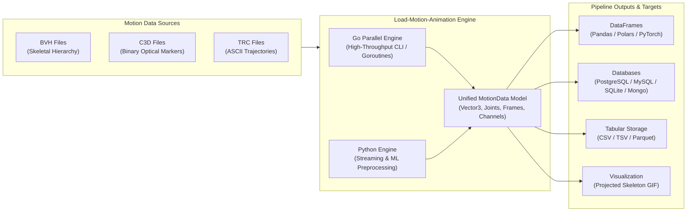

# Load-Motion-Animation 🎬

<p align="center">
  <strong>High-Performance 3D/2D Motion Capture Parser, Batch Preprocessing & Pipeline Engine</strong><br>
  <em>Built for AI/ML Motion Synthesis, Text-to-Motion Research, Biomechanics, and Data Pipelines</em>
</p>

<p align="center">
  <a href="https://gitlab.com/mireu-lab/Load-motion-animation/-/pipelines"></a>
  <a href="https://pkg.go.dev/gitlab.com/mireu-lab/Load-motion-animation"></a>
  <a href="https://golang.org"></a>
  <a href="https://python.org"></a>
  <a href="LICENSE"></a>
</p>

<p align="center">
  <a href="README.md">English</a> | <a href="README.ko.md">한국어 (Korean)</a>
</p>

---

## 📌 1. Overview & Purpose

**Load-Motion-Animation** is a dual-engine (**Golang & Python**) motion processing library designed specifically for **batch ingestion, stream parsing, data preprocessing, and automated pipelines** of diverse motion capture (mocap) and animation datasets.

### 🎯 Why Load-Motion-Animation?

Modern AI motion research—such as **Text-to-Motion**, **Motion Diffusion Models (MDM)**, **Human Pose Estimation**, and biomechanics analysis—heavily relies on processing massive repositories of motion capture files (e.g., AMASS, HumanML3D, BABEL, CMU Mocap, KIT). 

However, motion data processing has suffered from several critical challenges:
1. **Format Fragmentation**: Formats like `BVH` (joint hierarchy & Euler angles), `C3D` (binary optical markers & analog channels), and `TRC` (ASCII trajectory markers) have disparate conventions and data representations.
2. **Memory Bottlenecks in Large Batches**: Traditional libraries load entire motion files into memory at once. Processing tens of thousands of motion files for ML training frequently triggers Out-Of-Memory (OOM) errors.
3. **Pipeline Inflexibility**: Existing tools rarely provide seamless bridging between high-throughput batch preprocessing and analytical dataframes (Pandas, Polars) or storage backends (PostgreSQL, MySQL, SQLite, MongoDB).

### 💡 Core Solution

**Load-Motion-Animation** bridges this gap by providing:
- 🚀 **High-Throughput Go Core**: Concurrent, low-latency, garbage-collection-friendly parsing and batch pipeline execution with zero runtime dependencies.
- 🐍 **Native Python ML Integration**: Direct zero-copy or streaming conversion into **Pandas**, **Polars**, and **NumPy/PyTorch** compatible tensors and dictionaries.
- 🌊 **Streaming Generators**: Ingest millions of frames iteratively without exhausting memory via `iter_motion_frames` (Python) and `StreamParser` (Go).
- 🗄️ **Multi-Target Exporters**: Instant conversion to relational DB batch SQL (PostgreSQL, MySQL, SQLite), document stores (MongoDB NDJSON), structured CSV/TSV, and animated 2D GIF previews.

---

## 🏗️ 2. Architecture & Pipeline Flow



---

## 📊 3. Supported Formats & Capabilities

| Format | Category | Representation | Streaming / Batch | Key Use Cases |
| :--- | :--- | :--- | :---: | :--- |
| **BVH** *(Biovision Hierarchy)* | Skeletal Motion | Hierarchical skeleton, channel offsets, rotational Euler angles | ✅ Supported | Text-to-Motion, Game character animation, humanoid robotics |
| **C3D** *(Coordinate 3D)* | Optical MoCap | Binary 3D marker cloud trajectories, analog sync signals | ✅ Supported | Biomechanics, gait analysis, sports science, clinical capture |
| **TRC** *(Track Row Column)* | Optical MoCap | ASCII 3D marker positions with frame timing & headers | ✅ Supported | OpenSim biomechanical modeling, motion laboratory pipelines |
| **CALIB** | Metadata | Sensor calibration transforms & camera parameters | ✅ Supported | Multi-camera sensor synchronization & camera calibration |

---

## ⚡ 4. Installation

### 🐹 Golang Package & CLI
```bash
# As a Go module dependency in your project
go get gitlab.com/mireu-lab/Load-motion-animation@v0.1.0

# Clone and build the high-speed CLI binary
git clone https://gitlab.com/mireu-lab/Load-motion-animation.git
cd Load-motion-animation
make build
# Binary is ready at bin/motion-parser
```

### 🐍 Python Package
```bash
# Install directly from repository
pip install git+https://gitlab.com/mireu-lab/Load-motion-animation.git#subdirectory=python

# Or local editable development
cd python
pip install -e .
```

---

## 🚀 5. Quick Start & Pipeline Examples

### 1) Python: Motion Preprocessing Pipeline for Machine Learning

Process multiple motion files, clean/normalize data, and yield batches for PyTorch / TensorFlow:

```python
import glob
from load_motion import load_motion, iter_motion_frames, to_dataframe

# -------------------------------------------------------------
# Batch Processing: Ingest and inspect multiple BVH/C3D files
# -------------------------------------------------------------
mocap_files = glob.glob("datasets/motions/**/*.bvh", recursive=True)

for file_path in mocap_files:
    motion = load_motion(file_path)
    print(f"Loaded: {motion.file_name} | Frames: {motion.total_frames} | FPS: {motion.frame_rate}")

    # Convert directly to Pandas or Polars DataFrame
    df = to_dataframe(motion, library="pandas")
    
    # Preprocessing: e.g. center root joint to origin (0, 0, 0)
    if "Hips_X" in df.columns:
        df["Hips_X"] -= df["Hips_X"].iloc[0]
        df["Hips_Z"] -= df["Hips_Z"].iloc[0]

# -------------------------------------------------------------
# Streaming Pipeline: Low-memory frame-by-frame processing
# -------------------------------------------------------------
def motion_dataset_generator(file_list):
    """Memory-efficient generator for massive training datasets."""
    for file_path in file_list:
        # Streams frame-by-frame without loading the entire file into RAM
        for frame in iter_motion_frames(file_path):
            # Extract joint positions as normalized feature vectors
            frame_features = [
                frame.joints[joint].x for joint in frame.joints
            ]
            yield frame.time_sec, frame_features
```

### 2) Python: Multi-Target Storage Export

```python
from load_motion import load_motion, export_csv, export_sql, export_json, export_gif

motion = load_motion("_sample/Sample_motion.bvh")

# 1. Export to CSV for tabular analytics
export_csv(motion, "output/motion_data.csv")

# 2. Generate SQL batch insert script (PostgreSQL, MySQL, SQLite)
export_sql(motion, "output/batch_insert.sql", db_type="postgresql")

# 3. Export to JSON/NDJSON for MongoDB or Elasticsearch
export_json(motion, "output/motion_data.ndjson", ndjson=True)

# 4. Render 3D skeleton animation to GIF
export_gif(motion, "output/preview.gif", max_frames=150, width=400, height=400)
```

### 3) Golang: High-Throughput Concurrent Batch Parser

Process thousands of motion capture files in parallel utilizing Go goroutines:

```go
package main

import (
	"fmt"
	"path/filepath"
	"sync"

	"gitlab.com/mireu-lab/Load-motion-animation/pkg/bvh"
	"gitlab.com/mireu-lab/Load-motion-animation/pkg/df"
	"gitlab.com/mireu-lab/Load-motion-animation/pkg/motion"
)

func processFile(parser motion.Parser, path string, wg *sync.WaitGroup, results chan<- string) {
	defer wg.Done()

	data, err := parser.ParseFile(path)
	if err != nil {
		results <- fmt.Sprintf("Error [%s]: %v", path, err)
		return
	}

	dataframe := df.FromMotionData(data)
	results <- fmt.Sprintf("Processed: %s | Frames: %d | Joints: %d", 
		filepath.Base(path), data.TotalFrames, len(dataframe.Columns))
}

func main() {
	files := []string{"_sample/Sample_motion.bvh"} // Add batch file paths here
	parser := bvh.NewParser()

	var wg sync.WaitGroup
	results := make(chan string, len(files))

	for _, file := range files {
		wg.Add(1)
		go processFile(parser, file, &wg, results)
	}

	wg.Wait()
	close(results)

	for res := range results {
		fmt.Println(res)
	}
}
```

---

## 🛠️ 6. CLI Toolkit (`motion-parser`)

The compiled Go CLI provides a powerful, zero-dependency tool for automation scripts and CI/CD pipelines.

```bash
# 1. Print structured summary of motion hierarchy and metadata
./bin/motion-parser -input _sample/Sample_motion.bvh -export summary

# 2. Convert BVH to CSV with frame timing
./bin/motion-parser -input _sample/Sample_motion.bvh -export csv -output motion.csv

# 3. Generate PostgreSQL/MySQL batch insert scripts
./bin/motion-parser -input _sample/Sample_motion.bvh -export sql -db postgresql -output insert.sql

# 4. Stream large C3D file directly into CSV (low memory consumption)
./bin/motion-parser -input _sample/arthuman-sample.c3d -stream -export csv -output stream.csv

# 5. Render 3D skeleton animation preview as GIF
./bin/motion-parser -input _sample/Sample_motion.bvh -export gif -output motion.gif -max-frames 120
```

### CLI Options Reference

| Flag | Default | Description |
| :--- | :--- | :--- |
| `-input` | *(Required)* | Path to input motion file (`.bvh`, `.c3d`, `.trc`) |
| `-export` | `summary` | Target export format: `summary`, `csv`, `sql`, `json`, `gif` |
| `-output` | stdout | Destination file path for exported artifacts |
| `-stream` | `false` | Enable memory-efficient streaming mode for huge files |
| `-db` | `postgresql` | SQL dialect when `-export sql` is chosen (`postgresql`, `mysql`, `sqlite`) |
| `-max-frames`| `150` | Maximum frames to render when exporting to GIF |
| `-width` / `-height` | `400` | Canvas dimensions for GIF rendering |

---

## 🧪 7. Testing & Verification

Comprehensive test suites covering unit tests, streaming verification, and Godoc examples:

```bash
# Run Go unit tests, Godoc examples, and race detector
go test -v -race -cover ./...

# Run Python unit tests
PYTHONPATH=python python3 -m unittest tests/test_python_loader.py

# Run all via Makefile
make test
```

---

## 📖 8. Documentation & API Reference

- **pkg.go.dev Official API Docs**: [https://pkg.go.dev/gitlab.com/mireu-lab/Load-motion-animation](https://pkg.go.dev/gitlab.com/mireu-lab/Load-motion-animation)
- **Local Interactive Godoc Server**:
  ```bash
  make godoc
  # Opens at: http://localhost:6060/pkg/gitlab.com/mireu-lab/Load-motion-animation/
  ```
- **GitLab Pages Static Site**:
  ```bash
  make godoc-html
  # Generates static HTML documentation in public/
  ```

---

## 🦊 9. CI/CD & Automation (.gitlab-ci.yml)

The repository includes an enterprise-grade GitLab CI/CD pipeline covering the entire lifecycle:
- **`test`**: Automated Go matrix tests, coverage validation, and Python test suites.
- **`build`**: Cross-platform binary compilation for **Linux**, **macOS**, and **Windows** (`amd64` / `arm64`).
- **`docs`**: Automated HTML documentation deployment to **GitLab Pages**.
- **`release`**: Automatic GitLab releases with attached binary artifacts, PyPI package publishing, and `pkg.go.dev` proxy cache warm-up.

---

## 🤝 10. Contributing

Contributions, bug reports, and feature proposals are welcome!
1. Fork the repository (`git clone https://gitlab.com/mireu-lab/Load-motion-animation.git`).
2. Create your feature branch (`git checkout -b feature/awesome-feature`).
3. Commit your changes (`git commit -m 'feat: add awesome feature'`).
4. Push to the branch (`git push origin feature/awesome-feature`).
5. Open a Merge Request (MR).

---

## 📄 11. License

This project is licensed under the **MIT License** - see the [LICENSE](LICENSE) file for details.
